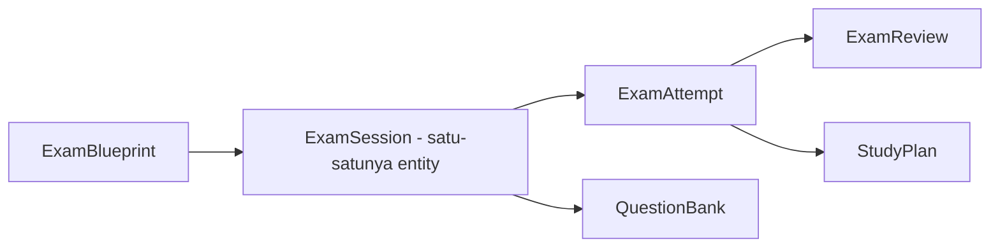

# Proposal Desain Unifikasi Exam Analyzer & Exam History

## 1. Alur Pengguna Baru (User Flow)

```
[1] Buka "Exam Analyzer"
     │
[2] Pilih Mata Kuliah → Lihat Dashboard Analisis (ringkasan topik, prioritas, kelemahan)
     │
[3] Konfigurasi Ujian Baru (dalam modal/drawer):
     │   - Tipe: Latihan / Kuis / UTS / UAS / Custom
     │   - Tingkat Kesulitan + Bloom Level + Format Soal
     │   - Jumlah Soal + Durasi (opsional)
     │   - Filter Materi (MaterialPicker)
     │   - Toggle: "Gunakan Bank Soal" (default ON, hemat token)
     │
[4] Generate Blueprint → Tampilkan sebagai ringkasan (bukan tabel penuh)
     │   - Persetujuan preview: topic × jumlah soal × bobot
     │   - Tombol "Generate Ulang" & "Lanjut ke Ujian"
     │
[5] Kerjakan Simulasi Ujian → QuizView (timer, navigasi soal)
     │
[6] Submit → Evaluasi & Pembahasan (ResultView + ReviewView terintegrasi)
     │
[7] Otomatis Tersimpan ke Riwayat (tanpa tombol "Selesai & Simpan" manual)
     │
[8] Riwayat & Latihan Ulang dalam satu halaman
     │   - Tab "Riwayat" menampilkan kartu histori
     │   - Tombol "Latihan Lagi" → generate ulang blueprint → redirect ke flow [4]
```

### Perubahan utama dari alur lama:
- **ConfigView & BlueprintView** tidak perlu berdiri sebagai view penuh; cukup modal/drawer.
- **Hilang tombol "Selesai & Simpan"** — penyimpanan riwayat otomatis setelah submit.
- **Halaman ExamHistory** digabung menjadi tab/view dalam ExamAnalyzerPage.
- **Retry** dari riwayat tidak perlu buka halaman terpisah; langsung trigger modal blueprint.

---

## 2. Penyederhanaan Entitas Data (Entity Model)

### Masalah saat ini:
| Entity | Tujuan | Masalah |
|--------|--------|---------|
| `ExamBlueprint` | Rencana ujian | ✅ Tetap diperlukan |
| `ExamSession` | Sesi ujian aktif | ❌ Overlap dgn HistorySession (keduanya simpan questions, answers, evaluation) |
| `ExamHistorySession` | Riwayat permanen | ❌ Duplikasi data dari ExamSession |
| `ExamAttempt` | Riwayat percobaan ulang | ✅ Tetap diperlukan |
| `ExamReview` | Review per-soal | ✅ Tetap diperlukan |
| `StudyPlan` + `StudyPlanItem` | Rencana belajar | ✅ Tetap diperlukan |
| `QuestionBank` | Bank soal reusable | ✅ Tetap diperlukan |

### Usulan desain baru:



**ExamSession** diperluas menjadi satu-satunya entity sesi yang mencakup peran `ExamSession` dan `ExamHistorySession` saat ini:

| Kolom | Tipe | Keterangan |
|-------|------|------------|
| `id` | PK | |
| `blueprint_id` | FK→exam_blueprints | Boleh NULL untuk sesi legacy |
| `subject_id` | FK→subjects.id | NOT NULL |
| `subject_name` | VARCHAR | Denormalized untuk query cepat |
| `title` | VARCHAR | |
| `exam_type` | VARCHAR | |
| `difficulty` | VARCHAR | |
| `bloom_level` | VARCHAR | |
| `question_type` | VARCHAR | |
| `total_questions` | INTEGER | |
| `duration_minutes` | INTEGER | |
| `status` | VARCHAR | `active` / `completed` / `archived` / `mastered` |
| `best_score` | INTEGER | |
| `latest_score` | INTEGER | |
| `grade` | VARCHAR | |
| `progress` | INTEGER | 0-100 |
| `weak_topics_json` | TEXT | |
| `strong_topics_json` | TEXT | |
| `evaluation_json` | TEXT | |
| `questions_json` | TEXT | Snapshot soal |
| `answers_json` | TEXT | Jawaban sesi terakhir |
| `started_at` | DATETIME | |
| `submitted_at` | DATETIME | |
| `created_at` | DATETIME | |
| `updated_at` | DATETIME | |

**Keuntungan:**
- Satu entity untuk semua status sesi (active → completed langsung jadi histori).
- Tidak perlu lagi `POST /api/history/save` terpisah.
- Relasi `Attempt` dan `Review` tetap cascade melalui `session_id` (bukan `history_session_id`).
- Query daftar histori = `SELECT * FROM exam_sessions WHERE status != 'active'`.

---

## 3. Jaminan Protected Baseline (Must Not Break)

### a. Auto-merge via `blueprint_id`

**Cara kerja saat ini (dipertahankan):**
- `generate_questions()` di `exam_service.py` memeriksa `QuestionBank` sebelum memanggil AI.
- Jika >= 80% (BANK_MIN_RATIO) soal untuk suatu topik sudah ada di bank, AI dilewati (zero AI).
- Soal baru dari AI tetap disimpan ke `QuestionBank` dengan `blueprint_id` sebagai referensi.

**Jaminan di desain baru:**
- `QuestionBank.blueprint_id` tetap dipertahankan.
- Auto-merge logic tidak disentuh karena tidak ada perubahan pada `ExamService.generate_questions()`.
- Hanya nama kolom FK di `Attempt` dan `Review` yang berubah dari `history_session_id` → `session_id`.
- `QuestionBank` tetap menggunakan `blueprint_id` asing ke `ExamBlueprint`, bukan ke `ExamSession`.

### b. Konsistensi urutan soal saat Retry (mode zero-AI)

**Cara kerja saat ini (dipertahankan):**
- `retry_from_bank()` di `exam_service.py` mengambil soal dari `QuestionBank` dengan filter `weak_topics`.
- Soal diacak (shuffle) untuk variasi, tetapi struktur topik (70% weak, 30% lain) tetap konsisten.
- Tidak ada panggilan AI → zero token cost.

**Jaminan di desain baru:**
- `retry_from_bank()` tidak diubah.
- Hanya endpoint yang dipindahkan: `POST /api/sessions/{session_id}/retry` (bukan `/api/exam/retry/{blueprint_id}`).
- Retry membuat `ExamAttempt` baru di bawah `ExamSession` yang sama (sama seperti `ExamAttempt` saat ini di bawah `ExamHistorySession`).

### c. Timer dan `subject_id` NOT NULL

**Cara kerja saat ini (dipertahankan):**
- `duration_minutes` di `ExamBlueprint` → dikirim ke frontend → `QuizView` menjalankan countdown lokal.
- `subject_id` sudah NOT NULL di semua entity (Blueprint, Session, HistorySession).

**Jaminan di desain baru:**
- `ExamSession` baru memiliki `duration_minutes` langsung (denormalized dari blueprint) sehingga timer bisa diakses tanpa JOIN.
- `subject_id` tetap NOT NULL + FK constraint.
- Timer logic di frontend (`QuizView`) tidak disentuh.

---

## 4. Rencana Migrasi Data Riwayat Lama

### Data yang perlu dimigrasi:

| Tabel Lama | Jumlah Baris (estimasi) | Tujuan |
|-----------|------------------------|--------|
| `exam_sessions` | Minimal (sesi aktif) | Tetap di `exam_sessions` (hanya tambah kolom) |
| `exam_history_sessions` | ~10-50 baris | `INSERT INTO exam_sessions SELECT ...` |
| `exam_attempts` | ~10-50 baris | Ganti FK `history_session_id` → `session_id` |
| `exam_reviews` | ~100-500 baris | Ganti FK `attempt_id` (tetap) |
| `study_plans` | ~5-20 baris | Ganti FK `history_session_id` → `session_id` |
| `study_plan_items` | ~50-200 baris | Tidak berubah (FK ke `study_plans.id`) |

### Langkah migrasi (1 script, transactional):

```python
# migration_unify_exam.py
# Langkah 1: Tambah kolom baru ke exam_sessions
ALTER TABLE exam_sessions ADD COLUMN subject_name VARCHAR;
ALTER TABLE exam_sessions ADD COLUMN status VARCHAR DEFAULT 'active';
ALTER TABLE exam_sessions ADD COLUMN best_score INTEGER;
ALTER TABLE exam_sessions ADD COLUMN latest_score INTEGER;
ALTER TABLE exam_sessions ADD COLUMN grade VARCHAR;
ALTER TABLE exam_sessions ADD COLUMN progress INTEGER DEFAULT 0;
ALTER TABLE exam_sessions ADD COLUMN weak_topics_json TEXT;
ALTER TABLE exam_sessions ADD COLUMN strong_topics_json TEXT;
ALTER TABLE exam_sessions ADD COLUMN duration_minutes INTEGER;
ALTER TABLE exam_sessions ADD COLUMN exam_type VARCHAR;
ALTER TABLE exam_sessions ADD COLUMN difficulty VARCHAR;
ALTER TABLE exam_sessions ADD COLUMN bloom_level VARCHAR;
ALTER TABLE exam_sessions ADD COLUMN question_type VARCHAR;
ALTER TABLE exam_sessions ADD COLUMN updated_at DATETIME;

# Langkah 2: Copy data dari exam_history_sessions ke exam_sessions
INSERT INTO exam_sessions (
    subject_id, subject_name, title, exam_type, difficulty, bloom_level,
    question_type, total_questions, best_score, latest_score, grade,
    progress, status, weak_topics_json, strong_topics_json, evaluation_json,
    questions_json, answers_json, created_at, updated_at
)
SELECT
    subject_id, subject_name, title, exam_type, difficulty, bloom_level,
    question_type, total_questions, best_score, latest_score, grade,
    progress, status, weak_topics_json, strong_topics_json, evaluation_json,
    questions_json, answers_json, created_at, updated_at
FROM exam_history_sessions;

# Langkah 3: Update FK exam_attempts → exam_sessions
# Buat lookup table: old_history_id → new_session_id
# UPDATE exam_attempts SET history_session_id = new_session_id WHERE ...;

# Langkah 4: Rename kolom di exam_attempts
ALTER TABLE exam_attempts RENAME COLUMN history_session_id TO session_id;

# Langkah 5: Update FK study_plans
ALTER TABLE study_plans RENAME COLUMN history_session_id TO session_id;

# Langkah 6: Drop exam_history_sessions (setelah semua data diverifikasi)
DROP TABLE exam_history_sessions;
```

### Rollback plan:
- Simpan backup `exam_history_sessions` sebagai `exam_history_sessions_bak` sebelum drop.
- Semua perubahan `ALTER TABLE ADD COLUMN` aman (nullable, tidak ada existing data conflict).

---

## 5. Tahapan Eksekusi Kode (Step-by-Step Implementation Plan)

### Sub-task A: Database Migration (1 file + 1 router update)

**File:**
- `main.py` — tambah fungsi `run_exam_unification_migration()` dengan langkah 1-6 di atas.
- `models.py` — tambah field baru ke `ExamSession`, hapus `ExamHistorySession` (atau mark `__tablename__ = None`).

**Verifikasi:**
- `pytest tests/test_exam_migration.py` — migrasi data lama tidak hilang.
- Hitung baris: `SELECT COUNT(*) FROM exam_sessions WHERE status != 'active'` = `SELECT COUNT(*) FROM exam_history_sessions_bak`.

### Sub-task B: Backend API Refactor (2 router files)

**Perubahan di `routers/exam_analyzer.py`:**
- Hapus endpoint `/api/exam/sessions/{subject_id}` (history view sudah jadi bagian dari ExamSession).
- Tambah endpoint `GET /api/sessions` — daftar semua sesi (active & completed) dengan filter `?subject_id=&status=`.
- Tambah endpoint `POST /api/sessions/{session_id}/retry` — retry di sesi yang sama → buat Attempt baru.
- Ubah `POST /api/exam/submit/{session_id}` agar **otomatis** update status menjadi `completed` + set `updated_at`.

**Perubahan di `routers/exam_history.py`:**
- Hapus seluruh file `exam_history.py`.
- Pindahkan endpoint `POST /api/history/save` menjadi internal call di `submit_and_evaluate()` (bukan endpoint publik).
- Pindahkan endpoint `POST /api/history/retry/{history_session_id}` ke `POST /api/sessions/{session_id}/retry`.
- Pindahkan endpoint `GET /api/history/detail/{history_session_id}` ke `GET /api/sessions/{session_id}`.
- Pindahkan endpoint `POST /api/history/study-plan/{history_session_id}` ke `POST /api/sessions/{session_id}/study-plan`.
- Pindahkan endpoint `POST /api/history/plan-item/{item_id}/toggle` — tetap.
- Pindahkan endpoint `DELETE /api/history/delete/{history_session_id}` ke `DELETE /api/sessions/{session_id}`.

**Verifikasi:**
- Semua endpoint lama masih jalan (redirect atau 301) selama 1 masa transisi.
- `POST /api/exam/submit` langsung menghasilkan baris di ExamSession tanpa perlu panggilan `/api/history/save`.

### Sub-task C: UI Consolidation (2 frontend files)

**Perubahan di `ExamAnalyzerPage.jsx`:**
- Tambah tab baru: "Riwayat" (view ke-10, `HistoryTab`).
- `HistoryTab` mengadopsi komponen dari `ExamHistoryPage.jsx` (HistoryCard grid, search, filter, sort).
- Detail modal menggunakan komponen yang sama (`DetailModal` / `OverviewTab` / `ReviewTab` / `StudyPlanTab` / `AttemptsTab`).
- Ubah `window.location.href = '/exam-history'` menjadi navigasi internal ke tab "Riwayat".
- Hapus tombol "Selesai & Simpan" — submit langsung menyimpan.

**Perubahan di `ExamHistoryPage.jsx`:**
- Ubah dari full page menjadi komponen `HistoryTab` yang bisa di-render di dalam `ExamAnalyzerPage`.
- `RetryButton` navigasi internal (bukan redirect ke `/exam-analyzer?retry=1`).

**Perubahan di `App.jsx`:**
- Hapus route `/exam-history` (atau redirect ke `/exam-analyzer`).

**Verifikasi:**
- Tidak ada regresi visual di 9 view yang sudah ada.
- Tab "Riwayat" muncul setelah user menyelesaikan ≥1 ujian.
- Retry dari riwayat membuka modal blueprint dalam halaman yang sama.

### Sub-task D: Tes Integrasi (opsional, 1 file)

- `tests/test_exam_unified_flow.py` — jalankan flow lengkap: config → blueprint → generate → submit → verifikasi histori otomatis tersimpan → retry → verifikasi attempt baru.

---

## Ringkasan File yang Berubah

| File | Perubahan |
|------|-----------|
| `models.py` | Tambah field ke ExamSession; hapus ExamHistorySession |
| `main.py` | Tambah migration DDL unifikasi |
| `routers/exam_analyzer.py` | Tambah endpoint CRUD sessions; hapus sessions_list |
| `routers/exam_history.py` | **Dihapus** (endpoint pindah ke exam_analyzer.py) |
| `services/exam_service.py` | Submit auto-save history; retry uses session_id |
| `services/exam_history_service.py` | **Dihapus** (logic pindah ke exam_service.py) |
| `frontend/src/pages/ExamAnalyzerPage.jsx` | Tambah tab Riwayat; hapus tombol "Selesai & Simpan" |
| `frontend/src/pages/ExamHistoryPage.jsx` | Ubah jadi komponen HistoryTab |
| `frontend/src/App.jsx` | Hapus route /exam-history |
| `frontend/src/services/api.js` | Gabung examAPI + examHistoryAPI |

---

**Status:** DRAFT — Menunggu review dan approval sebelum eksekusi kode.
